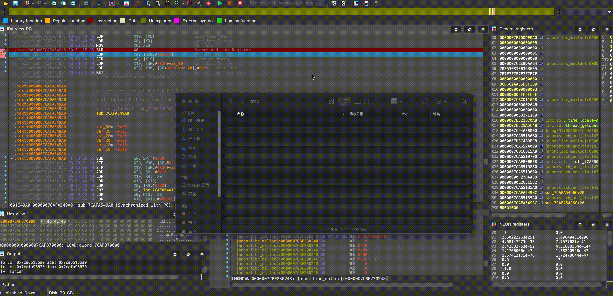

# Unicorn ARM64 Tracer（IDA + 离线回放）

[English](./README.md)



基于 Unicorn 的 ARM64 追踪工具链。

- `dyn_trace_ida.py`：IDA 插件（交互式 dump + trace）
- `local_emu.py`：离线回放 / 连续回放
- `single_script/dynamic_dump.py`：IDA 单文件兜底脚本

## 安装

```bash
pip install unicorn capstone
```

将以下内容放入 IDA `plugins` 目录：

- `dyn_trace_ida.py`
- `unicorn_trace/`

## IDA 插件（当前行为）

在 IDA 中按 `Ctrl-Alt-U` 打开（`Unicorn ARM64 Tracer`）。

插件窗口是**非模态弹窗**，默认置顶。

### 参数

- `END addr`：十六进制；**默认相对 image base**
- `TPIDR`：可选
- `Bound start / Bound end`：自定义运行区间
- `Output path`：输出目录
- `enable Tenet`：输出 Tenet 日志
- `end addr absolute`：将 END 按绝对地址解释

### 当前界面逻辑

- Auto range 取 **当前 PC 所在可执行段**。
- 点击 `Refresh Range` 会自动覆盖 `Bound start/end`。
- Custom bound 永久开启（不再有开关按钮）。
- 运行日志支持弹窗动态显示（`Show Log` / `Clear Log`）。

### 输入与输出缓存

按 IDB 维度做缓存（保存在用户 IDA 目录 `~/.idapro/...`）。
重新打开插件会恢复上次输入和上次输出路径。

## 使用路径（两条线，均需安装插件）

两条路径都要求先把 `dyn_trace_ida.py` 和 `unicorn_trace/` 放到 IDA `plugins` 目录。

### 路径 A：插件 GUI

1. 在 IDA 中按 `Ctrl-Alt-U` 打开窗口。
2. 填参数。
3. 点击 `Run Tracer`。

### 路径 B：IDA 脚本

在 IDA Python 环境运行：

```python
# 方式1：直接在 IDA 里执行脚本文件
# File -> Script file... -> 选择 dyn_trace_ida.py

# 方式2：导入并调用
import dyn_trace_ida
dyn_trace_ida.uni_trace_main(
    endaddr_input=0x1234,          # 默认相对地址
    tpidr_value_input=None,
    enable_tenet=False,
    user_path=".",
    end_addr_absolute=False,
    use_custom_bound=True,
    bound_start=0x100000000,
    bound_end=0x100010000,
)
```

## 输出文件

输出在 `Output path` 下：

- `uc_combine_<timestamp>.log`
- `dump_<timestamp>/regs.json`
- `dump_<timestamp>/uc.log`
- `dump_<timestamp>/tenet.log`（开启 Tenet 时）
- `tenet_combine_<timestamp>.log`（开启 Tenet 时）

`uc.log` 为逐指令人类可读日志，各列定宽对齐（时间 / PC / 相对基址偏移 / 指令字节 / 反汇编 / 执行前寄存器 => 执行后寄存器）：

```text
[00:16:29 138]  [0x737c3978cc]  [0x0148cc]  [fc6fbaa9]  "stp x28, x27, [sp, #-0x60]!"       x28=0x765d2b2640 x27=0x74b683a470 sp=0x7fcd7f6130 => sp=0x7fcd7f60d0
[00:16:29 138]  [0x737c3978d0]  [0x0148d0]  [fd430191]  "add x29, sp, #0x50"                sp=0x7fcd7f60d0 => x29=0x7fcd7f6120
[00:16:29 138]  [0x737c3978d4]  [0x0148d4]  [ff8327d1]  "sub sp, sp, #0x9e0"                sp=0x7fcd7f60d0 => sp=0x7fcd7f56f0
[00:16:29 138]  [0x737c3978dc]  [0x0148dc]  [82008052]  "mov w2, #4"                        w2=0x21c0228 => w2=0x4
```

- PC / 偏移列宽按本次 trace 的地址范围自动计算，反汇编列与寄存器列固定起始列；可调参数：`TRACE_MIN_PC_WIDTH`、`TRACE_MIN_OFFSET_WIDTH`、`TRACE_INSN_WIDTH`、`TRACE_COL_GAP`。
- 无读取寄存器的指令会显示被覆盖寄存器的旧值；无写入寄存器时省略 `=>`。
- 条件跳转、`cmp` 等涉及标志位的指令会以 `nzcv: N=.., Z=.., C=.., V=..` 展示。

## 离线回放

`local_emu.py` 常用入口：


- `run_once(...)`：回放单个 dump 文件夹
- `run_all_continuous(...)`：按时间顺序回放多个 `dump_*` 并合并日志

示例：

```python
from local_emu import run_all_continuous

run_all_continuous(
    dump_path="./tmp/report_list",
    debug_switch=True,
)
```

带 hook 的示例可参考 [`example.py`](./example.py)。

## 流程演示


## 注意

- 插件恢复路径仍使用 `ida_dbg.run_to(...)`，调试事件可能触发 IDA 视图切换。
- 建议运行前关闭无关断点，减少干扰。
- 中途失败不会破坏旧 dump，已有结果可继续复用。

## 参考

- 看雪文章：https://bbs.kanxue.com/thread-289135.htm
- Tenet 官方仓库：https://github.com/gaasedelen/tenet
- Tenet-IDA9.0：https://github.com/jiqiu2022/Tenet-IDA9.0

## 当前目录结构

```text
.
├── dyn_trace_ida.py
├── local_emu.py
├── example.py
├── unicorn_trace/
│   ├── __init__.py
│   └── unicorn_class.py
├── single_script/
│   ├── dynamic_dump.py
│   └── dump_single.py
├── README.md
└── README_zh.md
```
